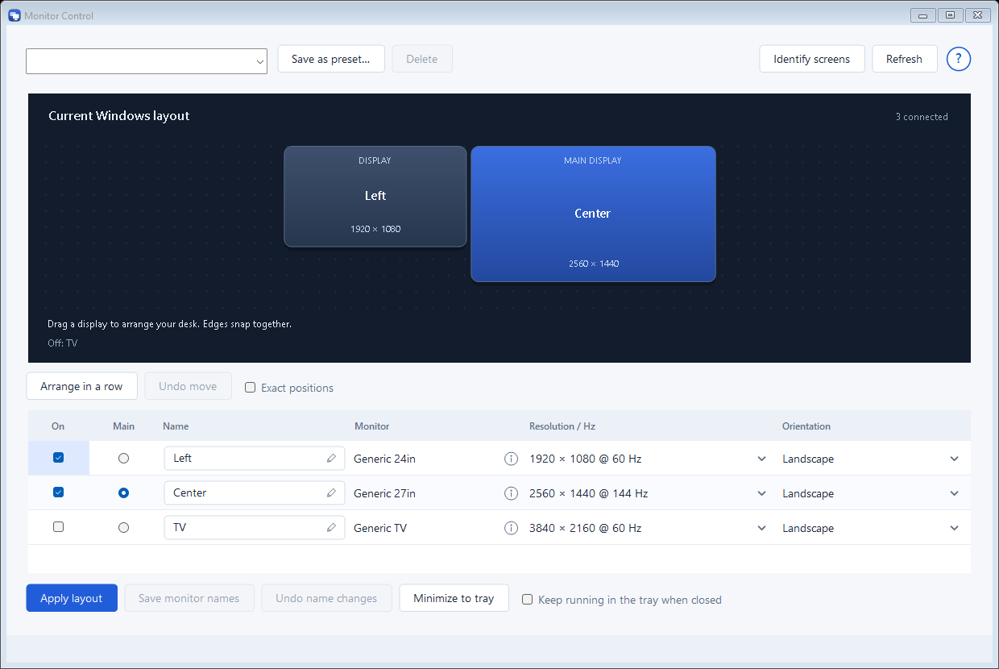
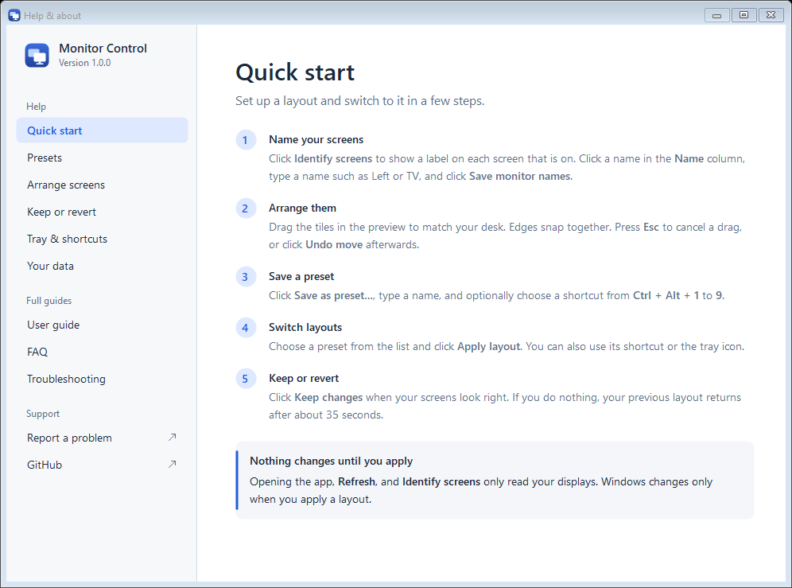

# Monitor Control user guide

Monitor Control saves the way your screens are arranged, and switches between those arrangements in one click. An arrangement is called a **layout**. A layout you have saved under a name is called a **preset**.

For example, you might keep one preset for when you work on your laptop alone, and another for when the laptop and an extra screen are both connected.

This guide covers the app from first run to uninstall. For quick answers, see the [FAQ](FAQ.md). If something goes wrong, see [Troubleshooting](TROUBLESHOOTING.md).

## Contents

- [What the app does and does not do](#what-the-app-does-and-does-not-do)
- [Getting started](#getting-started)
- [A tour of the main window](#a-tour-of-the-main-window)
- [Name your monitors](#name-your-monitors)
- [Save, apply, load, edit, and delete presets](#save-apply-load-edit-and-delete-presets)
- [Arrange your monitors](#arrange-your-monitors)
- [Keep changes: the confirmation window](#keep-changes-the-confirmation-window)
- [Shortcuts and the tray icon](#shortcuts-and-the-tray-icon)
- [Share a monitor between two computers](#share-a-monitor-between-two-computers)
- [Get help in the app](#get-help-in-the-app)
- [Where your data is stored](#where-your-data-is-stored)
- [Back up or reset your data](#back-up-or-reset-your-data)
- [Uninstall](#uninstall)

## What the app does and does not do

Monitor Control changes which screens are on, where they sit next to each other, which one is the **main** screen, and the resolution, refresh rate, and orientation of each one. It makes these changes through Windows' own display settings.

Terms used here:

- **Main screen**: the screen Windows treats as primary. The taskbar appears on it by default.
- **Resolution**: the number of dots (pixels) across and down the screen, such as 1920 × 1080.
- **Refresh rate**: how many times per second the screen redraws its picture, in hertz (Hz).
- **Orientation**: whether a screen is wide (landscape) or tall (portrait).

The app does **not**:

- Switch a monitor's input. An input is the connection a monitor is showing, such as HDMI or DisplayPort. Changing it is done with the monitor's own buttons or software.
- Control HDR (a display mode with a wider range of brightness and color).
- Change Windows text or app scaling, which sets how large text and icons appear.
- Change color profiles or brightness.
- Turn a monitor off at the power level. Turning a screen off in a layout only removes it from Windows' list of active displays. See [Share a monitor between two computers](#share-a-monitor-between-two-computers).
- Mirror one screen onto another. Each screen shows its own part of the desktop.

Opening the app, clicking **Refresh**, and clicking **Identify screens** never change your displays. A change happens only when you apply a layout, with **Apply layout**, a tray menu item, or a shortcut.

## Getting started

### 1. Download and extract the app

1. Open the [latest release](https://github.com/coffeerunsmycode/monitor-control/releases/latest) page on GitHub.
2. Download **MonitorControl-portable.zip**.
3. Extract the zip into a folder you will keep, such as **Documents**.

The zip contains **MonitorControl.exe**, a README file, and the license. This guide, the FAQ, and Troubleshooting are built into the app, so you can read them in its Help window without an internet connection. There is no installer, and you do not need administrator rights. The app stores its settings in your Windows user profile, not in the folder you extracted it to.

### 2. Run MonitorControl.exe

1. Open the folder you extracted.
2. Double-click **MonitorControl.exe**.
3. If Windows shows a SmartScreen warning that it does not recognize the app, click **More info**, then click **Run anyway**.

**What the SmartScreen warning means:** Monitor Control is not code-signed. Code signing is a way for a publisher to prove who made a program. Without it, Windows cannot confirm the publisher, so it shows a warning. The warning is about the missing signature. It is not a finding that the file is harmful. Only continue if you downloaded the zip from the official release page linked above.

When the window opens, nothing on your displays has changed. The preview's heading says **Current Windows layout**, and its top-right corner shows how many monitors Windows can see, including ones that are off.

## A tour of the main window

From top to bottom:

- **Top row:** on the left, a drop-down list of your saved presets (it says **Choose a preset…**, or **No presets yet**), followed by **Save as preset…** and **Delete**. On the right, **Identify screens**, **Refresh**, and a round **?** button. Click **?**, or press **F1**, to open the Help & about window.
- **Preview:** a drawing of your screens. Its heading names what the table holds: **Current Windows layout**, a preset's name, or **Unsaved layout** (after you delete the preset it came from). **· edited** appears after you change something. Each tile shows the screen's name and resolution. The main screen's tile says **MAIN DISPLAY**. Screens that are off are listed in the line that starts with "Off:" at the bottom of the preview.
- **Tool row:** **Arrange in a row**, **Undo move**, and the **Exact positions** check box.
- **Monitor table:** one row for each monitor. The columns are **On**, **Main**, **Name**, **Monitor**, **Resolution / Hz**, and **Orientation**. When you check **Exact positions**, **Left (px)** and **Top (px)** also appear.
- **Action row:** **Apply layout**, **Save monitor names**, **Undo name changes**, **Minimize to tray**, and the **Keep running in the tray when closed** check box.
- **Status bar:** the strip along the bottom edge. It explains what the app did last, or what it needs from you.

In the table:

- **On** means the screen is part of the layout. An unchecked screen is turned off in the layout.
- **Main** marks the main screen. It is a round option button, because exactly one screen that is on is the main screen.
- **Monitor** shows the model name reported by the monitor. If a saved monitor is not connected right now, this column shows **Unavailable** in grey. The **i** icon at the right of the cell opens that monitor's hardware details.

## Name your monitors

Each monitor starts with its model name. To give it a friendly name, such as **Left**, **Center**, or **TV**:

1. Click **Identify screens**. A blue label showing the name and model appears on each screen that is on in Windows. It stays for a few seconds.
2. In the **Name** column, click a name (the box with a pencil) and type the new name. Press **Enter** or click elsewhere to finish.
3. Click **Save monitor names**.

Notes:

- A name you changed but have not saved has a blue border and a blue pencil. It is not kept until you click **Save monitor names**. Applying a layout or saving a preset does not save it.
- To undo: while typing, press **Esc** to cancel or **Ctrl + Z** to undo the last change. After you finish typing, click **Undo name changes** to go back to the saved names.
- Unsaved names stay in the table when you refresh, choose a preset, or apply a layout. They are lost when you close the app.
- Names apply to every preset. Changing a name in one preset changes it everywhere.
- **Identify screens** shows the names you have saved, not names you have typed but not saved. Click **Save monitor names** first.
- If you leave a name blank, the app uses **Monitor**.
- To see technical details about a monitor, click the **i** icon in its **Monitor** cell. The window shows the model, the serial number if the monitor reports one, and the Windows address for the connection. It contains hardware serial numbers, so do not share a screenshot of it.

## Save, apply, load, edit, and delete presets

### Save a preset

1. Arrange the monitors in the table and the preview. See [Arrange your monitors](#arrange-your-monitors).
2. Click **Save as preset…**.
3. Type a **Preset name**. Use 1 to 80 characters. If the table holds a preset, its name and shortcut are already filled in, so you can save over it straight away.
4. Optional: choose a **Global shortcut (while the app is running)**, from **Ctrl + Alt + 1** to **Ctrl + Alt + 9**. Leave it as **None** if you don't want one.
5. Click **Save preset**.

Notes:

- The preset saves what is in the table, not what was last applied. It also saves the monitors that are off.
- Preset names are not case-sensitive. **Laptop** and **laptop** are the same name.
- If the name already exists, the app asks **Replace the saved preset “Name”?**. Click **Yes** to replace it.
- A shortcut can belong to only one preset. If you choose one that another preset uses, the app shows "That shortcut is already assigned to another preset."
- The app has no limit on how many presets you can save. Only presets 1 to 9 can have a shortcut.

### Apply a preset

1. Choose the preset in the drop-down list. The table and preview fill with the preset's settings, and the preview's heading shows its name. Windows has not changed yet.
2. Click **Apply layout**.
3. When the **Keep this display layout?** window appears, click **Keep changes** if your screens look right. See [Keep changes: the confirmation window](#keep-changes-the-confirmation-window).

You can also apply a preset from the tray menu or with its shortcut, without opening the main window.

### Edit a preset

1. Choose the preset in the drop-down list.
2. Make your changes. The preview's heading shows **· edited**.
3. Click **Apply layout** to apply the changes without saving them. Or click **Save as preset…** and **Save preset**, then **Yes**, to replace the preset.

Choosing a preset replaces any unsaved changes in the table.

### Apply layout

**Apply layout** applies the values in the table: the current layout, a preset you chose, or either one after your edits. It does not change your presets or save monitor names. Use **Save monitor names** for that.

### Rename a preset

The app has no rename option. Choose the preset in the drop-down list, click **Save as preset…**, type the new name, and save it. Then select the old preset and click **Delete**.

### Change a preset's shortcut

Save the preset again with the same name. Choose the new shortcut, or **None**, and click **Yes** when asked to replace the preset.

### Delete a preset

1. Choose the preset in the drop-down list.
2. Click **Delete**.
3. Click **Yes** in the **Delete “Name”?** message.

Deleting a preset does not change your displays. It also removes that preset's shortcut.

## Arrange your monitors

### Choose which screens are on

- Check **On** to include a screen in the layout. Uncheck it to turn the screen off in the layout.
- Select **Main** for the screen that should be the main screen. Selecting it also turns that screen on and clears **Main** from the other screens.
- If you uncheck **On** for the main screen, **Main** moves to the first screen in the table that is still on.

The app will not apply a layout unless exactly one enabled screen is the main screen. In that case it shows the message "Choose exactly one enabled monitor as primary."

### Drag screens in the preview

1. Click a tile in the preview, or click a row in the table, to select a screen.
2. Drag the tile to where it should be on your desk. You need at least two screens that are on. Screens that are off cannot be dragged. Turn them on first.
3. When a tile is close to the edge or center of another tile, it snaps into line.
4. Release the mouse. The tile moves to the nearest valid position beside another screen. The status line says "Arrangement updated. Apply the layout or save it as a preset."

While you drag, press **Esc** to cancel. The screen returns to where it was before the drag.

The arrangement must follow these rules:

- Every screen that is on must touch another screen along an edge.
- Screens must not overlap.
- Moving a screen cannot split the group of screens apart.

If a layout breaks a rule, the app shows a message such as "Displays overlap. Use Arrange in a row or edit their positions. Mirroring is not supported in this version." or "Enabled displays must touch along an edge. Use Arrange in a row to close gaps."

### Arrange in a row

Click **Arrange in a row** to place all screens that are on in one line, with their tops aligned. The order is the same as their current order from left to right.

Use this when a layout has become messy or has gaps. You can then drag screens to fine-tune it.

### Undo move

**Undo move** reverts the last drag. It goes back one step only. It is cleared when you click **Refresh**, choose a preset, or click **Arrange in a row**.

### Exact positions

Check **Exact positions** to show the **Left (px)** and **Top (px)** columns. The values update as you drag a screen. You can also type a number to place a screen exactly. Numbers must be whole numbers. Otherwise, the app shows "Display positions must be whole numbers."

Positions are measured in pixels from the main screen. The main screen is always at 0, 0 when the layout is applied. A negative number places a screen to the left of, or above, the main screen.

### Resolution / Hz

The drop-down list shows the resolutions and refresh rates that your graphics driver reports for that screen, largest first. The app can only set a combination that appears in this list.

The driver is the software that lets Windows use your graphics card.

### Orientation

The **Orientation** column has four choices: **Landscape**, **Portrait (90°)**, **Landscape (180°)**, and **Portrait (270°)**.

Changing between landscape and portrait swaps the width and height of the current resolution. For example, 1920 × 1080 becomes 1080 × 1920. The new size is shown right away, but Windows decides whether it is supported when you apply the layout. If it is rejected, see [Troubleshooting](TROUBLESHOOTING.md#a-resolution-or-refresh-rate-is-missing-or-rejected).

## Keep changes: the confirmation window

Every time you apply a layout, from **Apply layout**, from the tray, or from a shortcut, the app:

1. Remembers your current layout so it can go back to it.
2. Applies the new layout.
3. Shows the **Keep this display layout?** window. It asks **Can you see and use your displays?** and shows a countdown: **Your previous layout will return automatically in** a number of seconds.

The window has two buttons:

- **Keep changes** accepts the new layout and shows "Layout applied and confirmed." It does not save monitor names. Use **Save monitor names** for that.
- **Revert** brings back the previous layout right away.

The countdown is about 35 seconds from the start of the change. If applying the layout took a while, the countdown can start below 35 seconds.

### If you do nothing

When the countdown reaches zero, the previous layout returns automatically.

### If you close the window with its X button

Closing the window counts as **Revert**.

### If you close Monitor Control or it crashes

The app does not let you close the main window or choose **Exit** from the tray menu while the countdown is running. If the app is closed in another way, or crashes, a separate recovery process still restores the previous layout when the countdown ends. This works as long as you have not clicked **Keep changes**.

### If the PC loses power or restarts during the countdown

If you restart, shut down or sign out, the change is not kept. The previous layout returns when you next sign in. This is the same as letting the countdown run out. Windows does not allow display changes while it is shutting down, so it cannot return any earlier.

If the PC loses power, the previous layout also returns at your next sign-in in most cases. If it does not, see [A previous change is awaiting recovery](TROUBLESHOOTING.md#a-previous-change-is-awaiting-recovery).

If you lock the PC during the countdown, the previous layout returns once you unlock it.

### If you cannot see the window

The window appears in the middle of the main screen and stays on top of other windows. If the main screen is off or hidden, you may not see it. Do nothing, and the previous layout returns when the countdown ends.

You can also use the keyboard. Press **Esc** to revert. Press **Tab** to move focus to **Keep changes**, then press **Enter** or the spacebar.

While the window is open, the app ignores other clicks, shortcuts, and tray menu choices.

### There is no undo after Keep changes

Once you click **Keep changes**, the app does not offer an undo. To return to an older setup, apply a preset you saved for it, or change the screens in Windows Settings under **System > Display**.

## Shortcuts and the tray icon

### Keyboard shortcuts

- Each preset can have one shortcut, from **Ctrl + Alt + 1** to **Ctrl + Alt + 9**.
- Shortcuts work while Monitor Control is running, including when it is minimized to the tray. They stop working when the app is closed.
- A shortcut applies its preset and shows the **Keep this display layout?** window.
- If another program already uses the same key combination, the app shows a balloon notice titled **Shortcut unavailable**. The preset is still available from the tray menu and the main window. To fix it, save the preset again with a different shortcut.

### The tray icon

The Monitor Control icon appears in the notification area, next to the clock. If you cannot see it, click the up arrow in the taskbar to show hidden icons.

- **Double-click** the icon to open the main window.
- **Right-click** the icon to open the menu. It contains:
  - **Open Monitor Control**
  - Each preset. A preset with a shortcut shows it beside the name.
  - **Help & about**
  - **Exit**

Choosing a preset from the menu applies it and shows the **Keep this display layout?** window.

### Minimize to tray

**Minimize to tray** hides the main window and keeps the app running in the tray. The first time the window goes to the tray, a notice says the app is still running there. It is not shown again.

### Exit and closing the window

By default, closing the main window with its X button quits the app. **Exit** in the tray menu does the same. When the app is not running, the tray menu and shortcuts are not available.

To make the X button send the app to the tray instead, check **Keep running in the tray when closed**. The setting is saved. To quit while it is on, choose **Exit** in the tray menu. Signing out or shutting down Windows still closes the app as usual.

### Start with Windows

Monitor Control does not start by itself when you sign in. Open it yourself when you need it.

## Share a monitor between two computers

You can use one monitor with two computers by giving each computer a preset that uses the monitor differently. For example:

- A **Laptop** preset with the shared monitor **On** unchecked, so this computer ignores it.
- A **Desktop** preset with the shared monitor checked **On**.

Set up the presets on each computer. Presets are saved on the computer where you create them.

Be aware of these limits:

- Turning a monitor off in a layout only disables its Windows display. The app does not change the monitor's input and does not send a power command.
- Whether the monitor then switches to the other computer depends on the monitor's own settings and on how it detects signals. Check the monitor's menu for an automatic input setting, if it has one.
- While the monitor is showing the other computer, this computer cannot see it. If a preset needs that monitor, the app says "is not available to this PC. Check its cable/input and refresh. No changes were made." Then nothing changes.

This hand-off has to be tested on your own hardware. Try it while you are at the monitor, and keep the **Keep this display layout?** window in mind as the safety net.

## Get help in the app

Click the round **?** button in the top-right corner of the main window, or press **F1**. You can also right-click the tray icon and choose **Help & about**.

Choose a page in the list on the left:

- **Help:** short pages on the main tasks, starting with **Quick start**.
- **Full guides:** this user guide, the FAQ, and Troubleshooting. They are built into the app, so they work without an internet connection. Click a blue link to jump to another section or guide.
- **Support:** **Report a problem** and **GitHub** open in your web browser. They are marked with an arrow. See [Report a bug](TROUBLESHOOTING.md#report-a-bug).

To scroll, use the mouse wheel, or click the page and use the arrow keys, **Page Up**, **Page Down**, **Home**, and **End**. Press **Esc** to close the window.

## Where your data is stored

Your settings and logs are stored only on your PC, in this folder:

`%LOCALAPPDATA%\MonitorControl`

To open it, press the Windows key and **R**, type `%LOCALAPPDATA%\MonitorControl`, and press **Enter**. If the folder does not exist, you have not saved anything yet.

The folder contains:

| File | What it holds |
| --- | --- |
| `settings.json` | Your monitor names, presets, and options such as **Keep running in the tray when closed**. |
| `settings.json.bak` | The copy of `settings.json` from before the last save. |
| `last-layout.json` | The layout as it was before the most recent change. |
| `activity.log` | A list of changes and errors. |
| `pending-*.json` | Recovery data for a change that has not been confirmed. The app normally removes it when the change is kept or reverted. |

These files contain monitor identifiers, such as serial numbers. Check them before you share them. See [Report a bug](TROUBLESHOOTING.md#report-a-bug).

## Back up or reset your data

### Back up

1. Right-click the **Monitor Control** tray icon and choose **Exit**.
2. Copy the `MonitorControl` folder to a safe place. To back up only your presets, copy `settings.json` and `settings.json.bak`.

### Restore a backup

1. Exit Monitor Control.
2. Copy your backed-up `settings.json` into `%LOCALAPPDATA%\MonitorControl`, replacing the existing file.
3. Start Monitor Control.

### Reset

1. Exit Monitor Control.
2. Delete `settings.json` from `%LOCALAPPDATA%\MonitorControl`. Delete `settings.json.bak` too if you want a clean start.
3. Start Monitor Control. It opens with no names and no presets.

Deleting a file cannot be undone unless you have a backup.

## Uninstall

Monitor Control does not install anything into Windows, and it does not start with Windows. The only registry entry it writes is a temporary one during the **Keep this display layout?** countdown, so the previous layout can return if Windows restarts. It removes the entry when you keep or revert the change.

Uninstall only when no countdown is running.

1. Right-click the tray icon and choose **Exit**.
2. Delete the folder that contains **MonitorControl.exe**.
3. Optional: delete the `MonitorControl` folder in `%LOCALAPPDATA%` to remove your settings and logs.

The app's license is in the [LICENSE](../LICENSE) file. Read the [README](../README.md) for more about the project.
